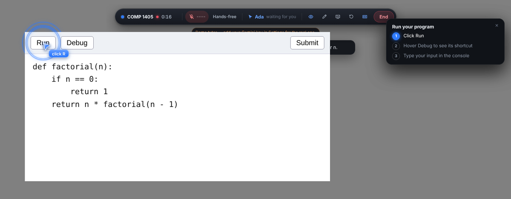
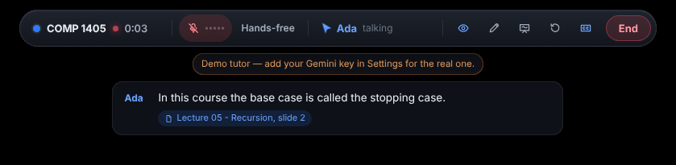

# Pairwise

**A live AI tutor that feels like a pair-programming call.** Pick a course in the menu bar,
press **Start session**, and Ada (the tutor) can see your screen, talk with you, glide her own
labeled cursor to things, draw on top of anything, walk you through steps, and — only when you
allow it — take the mouse and keyboard to show you. She teaches from your course folder, using
your professor's terms, and writes session notes into that folder when you're done.

Built for macOS (v1), structured so Windows/Linux can follow (`src/main/platform/`). Gemini only.

| | |
|---|---|
| Plan, stack and architecture | [PLAN.md](PLAN.md) |
| Every decision made without asking | [DECISIONS.md](DECISIONS.md) |
| Things only you can do (key, permissions, signing) | [BLOCKERS.md](BLOCKERS.md) |
| What was built and how each part was tested | [PROGRESS.md](PROGRESS.md) |
| How Tuple, HeyClicky and the Gemini API were studied | [docs/RESEARCH.md](docs/RESEARCH.md) |
| Credits | [NOTICE.md](NOTICE.md) |

---

## What it looks like

These are real captures from the end-to-end tests (Linux/Xvfb, with the scripted demo tutor). On
a Mac the system fonts and window chrome differ; the overlay, cursor and ink are the same.

| | |
|---|---|
|  | **Pointing at 2×.** The session bar runs across the top. Ada's circle is fitted to the button's real edges, found by grounding on a full-resolution capture, not drawn around a guess. |
|  | **Ask by drawing.** Hold ⌃⌥, talk, and circle something. Your orange marks, a zoomed crop and your words go to her as one question. |
|  | **Step by step.** A checklist card. She points at the next thing to click and waits until you do it. |
|  | **Pointing accuracy check** (Setup & checks). Labelled buttons on every display, each found on a real capture and scored in pixels. |
|  | **Captions and citations.** When she teaches from your course, the source is chipped under her caption. |
|  | **Course brain.** Summary, topics, the course's own terms, and a search box to test what she'd find. |
|  | **She drives (with your permission).** An amber frame, an "Ada is driving" banner, and her cursor riding yours. Move the mouse or press Esc and control is yours again. |
|  | **Risky actions ask first.** Submitting, sending, deleting or running anything gets a red card that points at exactly what would be clicked. |
|   | **App Veil.** What you see (left), and what Ada receives (right): the veiled window is black in every frame before anything leaves your Mac, even where it's partly covered. |
|  | **Whiteboard.** Her cursor draws the diagram box by box as she explains. You can draw on it too. |
|  | **Onboarding.** API key, the three macOS permissions, and how you want to talk. |

---

## Setup

You need **macOS 14 or newer**, **Node.js 22+** and npm (`brew install node`). Nothing is
compiled on your Mac — the native pieces are prebuilt.

```sh
cd pairwise
npm install          # prints which native helpers loaded (all three should say ✓)
npm run dev          # starts the app
```

The first launch opens onboarding, which walks you through:

1. **A Gemini API key** — from <https://aistudio.google.com> → *Get API key* (the project with
   your credits). It's stored encrypted in your login keychain. No key? The app still runs with a
   **scripted demo tutor**, so you can try everything below except real understanding.
2. **Three macOS permissions** — Screen & System Audio Recording, Microphone, Accessibility.
   When running from source macOS lists them under **Electron** (or your terminal). After turning
   on Screen Recording, quit and reopen the app. Details: [BLOCKERS.md](BLOCKERS.md) B-2.
3. **How you want to talk** — hands-free, or hold the ask keys (⌃⌥) while you speak.

If `npm run dev` ever says **"Error: Electron uninstall"**, run `npx install-electron --no` once.
That downloads the Electron app, which `npm install` now does for you.

Then add a course (COMP 1405 and COMP 1805 are one click away), **link its folder** (slides, PDFs,
notes, transcripts, assignment specs, code), and start a session.

### Packaged app

```sh
npm run dist:mac     # → dist/Pairwise-0.1.0-arm64.dmg (and x64), unsigned
```

Open the `.dmg`, drag Pairwise to Applications, then right-click → **Open** the first time
(unsigned). Signing for sharing it with others: BLOCKERS.md B-4.

### Tests

```sh
npm test             # unit + integration (vitest): geometry, Live protocol, grounding, beat sync,
                     # course brain, takeover rules, App Veil, diagrams …
npm run test:e2e     # the real app end to end (Playwright for Electron) against a local Gemini
                     # Live mock: shell, voice, pointing accuracy (1× and 2×), draw-and-ask,
                     # steps, calibration, course brain, takeover, App Veil, whiteboard, notes
npm run eval:grounding   # with GEMINI_API_KEY set: the pointing-accuracy test using real Gemini
```

The e2e suite is meant for Linux/CI (it runs inside a private Xvfb display). On a Mac it would
take over your screen for ~15 minutes; use the in-app checks instead (Setup & checks).

---

## Shortcuts (all editable in Settings → Shortcuts)

| | |
|---|---|
| **⌃⌥** (hold) | Ask: talk, and drag to circle/underline — release to send it all as one question |
| ⌃⌥D | Draw mode without holding keys (Return sends, Esc cancels, Shift = straight line) |
| ⌃⌥S | Start / end a session (last course) |
| ⌃⌥M | Mute / unmute |
| ⌃⌥V | Pause / resume what the tutor can see |
| ⌃⌥W | Whiteboard |
| ⌃⌥R | Say that again |
| ⌃⌥C | Clear drawings |
| ⌃⌥G | Allow the tutor to drive (when it asks) |
| ⌃⌥P | Pause / resume your video |
| ⌃⌥K | Hands-free ↔ hold-to-talk |
| ⌃⌥T | Captions on / off |
| ⌃⌥H | Show / hide the session bar |
| Esc / move the mouse | Take control back instantly |

---

## Demo script — try every feature

Run through this once with your key (the real tutor) — it takes about 15 minutes. Without a key
the demo tutor follows a script instead: the same features happen, in this order, each time you
say something or release the ask keys.

**Before you start:** add COMP 1405 and link a folder that has a few lecture slides/PDFs (the
generated test course works too: `node -e "import('./test/fixtures/make-course.mjs').then(m=>m.makeCourseFolder('/tmp/comp1405'))"`
then link `/tmp/comp1405`). Open some code or a slide on screen.

### 1. Session basics
1. Menu bar → **COMP 1405 → Start session** (or ⌃⌥S). The hub steps aside; the session bar
   (HUD) appears at the top with the course, a timer, the mic level and **End**. A small
   "Ada can see this screen" pill sits bottom-right; the menu-bar icon shows a live dot.
2. Ada greets you. **Captions** for both of you appear under the HUD (CC button toggles them).
3. Press ⌃⌥M (mute) and again; press ⌃⌥V to pause her view (the pill says so) and again.
4. *Two monitors?* Move your pointer to the other display — she says she's looking there now.

### 2. Voice and interruption
1. Ask "can you explain what a recursive function is?" and, while she's talking, say "wait —".
   She stops within a fraction of a second and listens.
2. Switch to hold-to-talk (HUD → *Hands-free* button). Now nothing is sent unless you hold ⌃⌥.
3. Press ⌃⌥R — **Say that again** replays her last answer, and any marks she made are redrawn in
   time with the words.

### 3. Her cursor and pen
1. Ask "where's the run button?" — her blue cursor (labeled **Ada**) glides there on an arc and
   parks with a label; a ring pulses around the button. Then it flies back to follow yours.
2. Ask her to "walk me through this function line by line". She plans a short explanation on a
   full-resolution screenshot and, as she says each line, **circles, underlines, arrows and
   handwritten notes** appear — drawn by her cursor, in time with her voice.
3. Ask "clear that" (or ⌃⌥C).
4. **Setup & checks → Pointing accuracy → Start test** (during a session): labelled buttons appear
   on every display, she finds each on a real screenshot and you see how many pixels off she was.
   **Preview** in the same place shows every mark kind without using the API.

### 4. Ask by drawing
1. Hold **⌃⌥**, say "what does this do?", and **drag a circle** around a line of code. Let go.
   Your orange marks, a zoomed crop and your words go to her as one question; she answers about
   exactly what you circled.
2. Trackpad: ⌃⌥D, draw, press Return.
3. Play a lecture video (YouTube in Safari/Chrome, Music, Spotify, QuickTime…) and ask something —
   it **pauses** when you start asking. Say "resume the video" (or the HUD's *Resume video*).

### 5. Step by step
1. Ask "how do I run my Python file from the Terminal?". A checklist card appears top-right.
   She points at exactly what to click and **waits**. Click it — the step ticks off, she continues.
   Steps she can't see ("type the command") wait for you to say "done". Finishing them all gets
   a little celebration.

### 6. Your course
1. Ask "what does my course call the base case?" — she searches your folder, answers in your
   professor's words, and a **source card** ("Lecture 05 - Recursion, slide 2") appears; the
   source is also chipped under her caption.
2. Ask about something beyond the course ("how does inheritance work?" in COMP 1405) — she says
   it isn't covered yet and a "Beyond this course" badge appears.
3. In the hub, open the course: **What Ada knows about this course** (summary, topics, the
   course's terms) and **Try a search**.
4. **Assignment mode:** mark a spec file as an assignment (or let it be detected: "A3…", "Lab 5…"),
   choose it in the dropdown next to Start session. Ask her to "just write the function for me" —
   she explains and hints instead, citing the spec and lectures.

### 7. She drives (with your permission)
1. Ask "can you show me where the Run button is in VS Code?". A card asks: **Let it drive**
   / Not now (or press ⌃⌥G, or just say "yes, go ahead").
2. While she drives: an amber glow around the screen, an "Ada is driving" banner, her cursor
   rides yours, and every move is a visible glide.
3. **Move your mouse** (or press Esc) — control comes back that instant, mid-action.
4. Let her drive again and ask her to submit something / run a command: a red **Allow this
   action?** card points at exactly what would be clicked. Cancel — nothing happens.

### 8. Whiteboard
1. Ask "can you draw the calls for factorial(3)?" — the whiteboard opens and her cursor flies onto
   it and draws the call tree box by box as she explains.
2. Draw on the board yourself (orange pen; eraser removes your strokes). ⌃⌥W hides/shows it.

### 9. Privacy
1. Open **Messages**: a dashed orange outline says it's hidden from Ada. Ask her what's in that
   window — she can't see it (it's black in every frame before anything leaves your Mac).
2. Settings → Privacy: choose which apps are veiled, notifications on/off, and whether notes may
   ever include screenshots (off by default).

### 10. Wrap up
1. Click **End**. A notes file appears in your course folder under **Pairwise notes/** — summary,
   key ideas, definitions, what to review, sources cited, the whiteboard diagram as an image and
   a condensed transcript. The hub lists it under *Session notes*.
2. Start again with **Pick up where we left off** — she recaps what you did last time.
3. **Usage** shows what each session cost and the month so far; set a monthly cap there (she warns
   at 80% and wraps up at 100%).

---

## Project layout

```
src/main/            Electron main process
  session/           the tutoring session: Live link, tools, cursor, ink, choreography
    features/        visual (point/annotate/explain), ask (draw-and-ask), steps, course,
                     takeover, veil, whiteboard, notes, calibrate
  courses/           course store + course brain (extract, chunks, search, profile)
  vision/            grounding (Gemini / OCR), control snapping, reader, planner, calibration
  gemini/            Live WebSocket client, REST client, local Live mock (demo + tests)
  platform/          everything OS-specific (displays, hooks, input driver, windows, media)
  windows/           hub, HUD, overlays, engine, whiteboard windows
src/renderer/        hub (React), HUD (React), overlay (canvas + DOM), engine (audio/capture),
                     whiteboard
src/shared/          types and pure logic shared by both sides (geometry, ink geometry, IPC)
test/                unit, integration, e2e (+ fixtures that generate a course folder)
```
